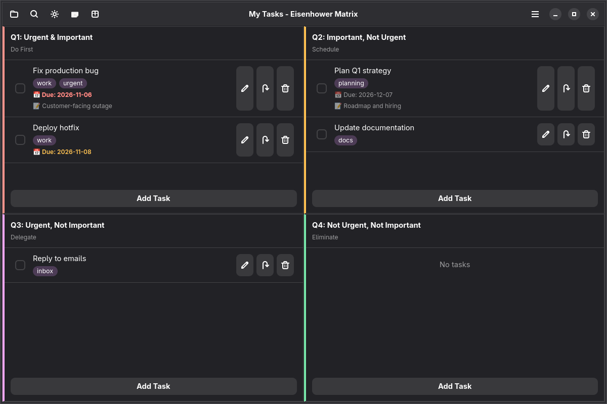
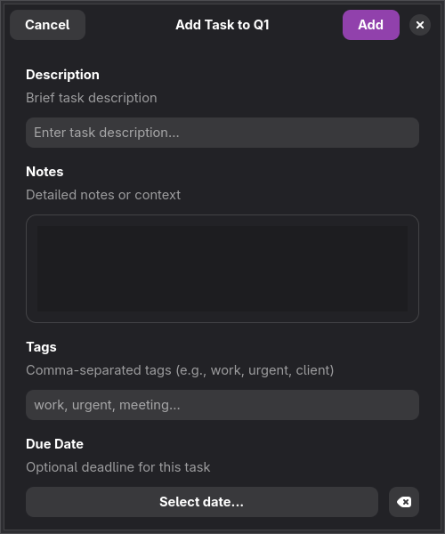

# Eisenhower Matrix

A modern GUI application for managing tasks using the Eisenhower Matrix method of prioritization. Features a beautiful GTK4 interface with libadwaita styling and full Flatpak support.


[](https://flathub.org/apps/io.github.alesima.eisenhower)

## What is the Eisenhower Matrix?

The Eisenhower Matrix is a time management framework that helps you prioritize tasks by categorizing them into four quadrants:

1. **Urgent & Important (Do First)** - Critical tasks that require immediate attention
2. **Important, Not Urgent (Schedule)** - Long-term goals and strategic planning
3. **Urgent, Not Important (Delegate)** - Tasks that need to be done but can be delegated
4. **Not Urgent, Not Important (Eliminate)** - Distractions and time-wasters to minimize

## Features

### Core Functionality
- ✨ **Beautiful GTK4 Interface** - Modern, aesthetic design using libadwaita
- 📦 **Flatpak Support** - Easy installation and sandboxed security
- 🏷️ **Rich Task Metadata** - Add notes, tags, and custom metadata to tasks
- 🔍 **Real-time Search** - Search tasks across all quadrants by description, notes, or tags
- 📅 **Due Dates with Visual Indicators** - Track deadlines with color-coded urgency (overdue/due soon)
- ✅ Four-quadrant task organization (Eisenhower Matrix)
- ✅ Task completion tracking with timestamps
- ✅ Move tasks between quadrants
- ✅ Reorder tasks within quadrants (up/down buttons)
- ✅ Persistent JSON storage

### Import/Export
- 📤 **Export**: JSON, CSV, Markdown, Calendar CSV
- 📥 **Import**: JSON (replace/merge), CSV, Calendar (iCal/ICS files)
- 🗓️ **Auto-quadrant assignment** for calendar imports based on due dates

### UI Features
- 🎨 **Light/Dark theme** with manual toggle
- 👁️ **Show/hide completed tasks** toggle
- ✏️ **Completed task styling** - strikethrough text, muted colors
- 🔒 **Completed task restrictions** - cannot be moved between quadrants
- ⚡ **Reactive updates** - Observer pattern for instant UI refresh
- 🔍 **Search bar** - Toggle to filter tasks in real-time
- 🔴 **Urgency indicators** - Visual color-coding for overdue (red), due soon (orange), and future tasks
- ⌨️ **Keyboard shortcuts** - Quick access to common actions (Ctrl+Q, Ctrl+E, Ctrl+T, etc.)

### Architecture
- 🏗️ **Hexagonal Architecture** - Clean separation of concerns
- 🎯 **SOLID Principles** - Maintainable and extensible code
- 📦 **Absolute imports** - Clear module dependencies
- 🔌 **Dependency injection** - Testable and flexible design
- 🌐 **Cross-platform** (Linux, macOS, Unix)

## Screenshots

### GUI Application
The GTK4 interface provides a clean, modern view of your tasks organized in four quadrants with color coding:
- 🔴 **Quadrant 1** (Urgent & Important) - Red accent
- 🟡 **Quadrant 2** (Important, Not Urgent) - Yellow accent
- 🔵 **Quadrant 3** (Urgent, Not Important) - Blue accent
- 🟢 **Quadrant 4** (Not Urgent, Not Important) - Green accent




Each task can include:
- **Description** - The main task title
- **Notes** - Additional details and context
- **Tags** - Organize and filter tasks by category
- **Custom Metadata** - Store any additional key-value information

## Installation

### Flatpak (Recommended)

Once approved on Flathub, the app is also available in GNOME Software
on GNOME-based distros — just search for "Eisenhower Matrix".

#### From Flathub

Once approved on Flathub:

```bash
flatpak install flathub io.github.alesima.eisenhower
flatpak run io.github.alesima.eisenhower
```

#### From Release Bundle

Download the `.flatpak` bundle from [GitHub Releases](https://github.com/alesima/eisenhower/releases):

```bash
flatpak install eisenhower-matrix.flatpak
flatpak run io.github.alesima.eisenhower
```

#### Build from Source

```bash
# Install Flatpak builder
sudo dnf install flatpak-builder  # Fedora
sudo apt install flatpak-builder  # Ubuntu/Debian
sudo pacman -S flatpak-builder    # Arch/EndeavourOS

# Build and install
./build-flatpak.sh

# Run
flatpak run io.github.alesima.eisenhower
```

### From Source

#### System Dependencies

**Fedora/RHEL:**
```bash
sudo dnf install python3 python3-pip python3-gobject gtk4 libadwaita
```

**Ubuntu/Debian:**
```bash
sudo apt install python3 python3-pip python3-gi gir1.2-gtk-4.0 gir1.2-adw-1
```

**Arch Linux:**
```bash
sudo pacman -S python python-pip python-gobject gtk4 libadwaita
```

#### Install Application

```bash
# Clone the repository
git clone https://github.com/alesima/eisenhower.git
cd eisenhower

# Install using pip
pip install .

# Or install in development mode
pip install -e .

# Or install system-wide
sudo pip install .
```

## Usage

### GUI Application

```bash
# Launch the GUI
eisenhower-gui

# Or via desktop launcher (after installation)
# Search for "Eisenhower Matrix" in your application menu
```

### Managing Tasks

#### Adding Tasks
1. Click the **+ Add Task** button in any quadrant
2. Fill in the task details:
   - **Description**: The main task title (required)
   - **Notes**: Additional context and details
   - **Tags**: Comma-separated tags (e.g., "work, urgent, client")
   - **Due Date**: Optional deadline (YYYY-MM-DD format, or click "Today")
   - **Metadata**: Custom key-value pairs for any additional information
3. Click **Save** to add the task

#### Editing Tasks
1. Click the **✏️ Edit** button on any task
2. Modify the task details as needed
3. Click **Save** to update the task

#### Searching Tasks
1. Click the **🔍 Search** icon in the header bar
2. Type to filter tasks in real-time across all quadrants
3. Search matches task descriptions, notes, and tags
4. Press Escape or click the search icon again to close

#### Due Date Indicators
Tasks with due dates display color-coded indicators:
- 🔴 **Red** (Overdue) - Task is past its due date
- 🟠 **Orange** (Due Soon) - Task is due within 3 days
- ⚪ **Gray** (Future) - Task is due more than 3 days from now

#### Task Actions
- **✓ Checkbox**: Mark task as completed
- **🗑️ Delete**: Remove the task
- **↔️ Move**: Drag to move between quadrants (if supported)

### Backup and Restore

1. Open the menu (☰) in the top-right corner
2. Select **Backup** submenu
3. Choose:
   - **Export Tasks...** - Save all tasks to a JSON file
   - **Import Tasks...** - Replace current tasks with imported file
   - **Import and Merge...** - Add imported tasks to existing ones

**Backup file format**: JSON format containing all tasks with metadata.

## Project Structure

```
eisenhower/
├── eisenhower_matrix/          # Main Python package
│   ├── domain/                # Core business logic (no dependencies)
│   │   ├── task.py           # Task entity
│   │   ├── quadrant_info.py  # QuadrantInfo entity
│   │   ├── task_repository.py # ITaskRepository port
│   │   ├── observer.py       # IObserver port
│   │   └── notification_service.py # INotificationService port
│   ├── application/           # Use cases and services
│   │   ├── matrix_service.py # EisenhowerMatrixService
│   │   ├── task_export.py    # Export use cases
│   │   ├── task_import.py    # Import use cases
│   │   └── task_management.py # Task management
│   ├── infrastructure/        # Adapters
│   │   ├── persistence/      # Storage adapters
│   │   │   └── json_repository.py
│   │   └── ui/               # GTK4 UI components
│   │       ├── application.py
│   │       ├── main_window.py
│   │       ├── task_row.py
│   │       └── quadrant_box.py
│   └── __init__.py           # Package initialization
├── data/
│   └── icons/                # Application icons
├── io.github.alesima.eisenhower.yml         # Flatpak manifest
├── io.github.alesima.eisenhower.desktop     # Desktop entry
├── io.github.alesima.eisenhower.metainfo.xml # AppData metadata
├── eisenhower-gui            # GUI entry point script
├── setup.py                  # Installation script
├── build-flatpak.sh          # Flatpak build script
├── requirements.txt          # Python dependencies
├── README.md                 # This file
├── ARCHITECTURE.md           # Architecture documentation
└── LICENSE                   # MIT license
```

## Architecture

The application follows **Hexagonal Architecture** (Ports and Adapters) with **SOLID principles**:

### Domain Layer (Core)
- **Entities**: `Task`, `QuadrantInfo` - Pure business logic
- **Ports**: `ITaskRepository`, `IObserver`, `INotificationService` - Interface contracts
- Zero dependencies on infrastructure

### Application Layer (Use Cases)
- **Services**: `EisenhowerMatrixService` - Orchestrates domain operations
- **Use Cases**: `TaskExportUseCase`, `TaskImportUseCase`, `TaskManagementUseCase`
- Import/Export: JSON, CSV, Markdown, Calendar formats
- Depends only on domain abstractions

### Infrastructure Layer (Adapters)
- **Persistence**: `JsonTaskRepository` - JSON file storage
- **UI**: GTK4/Adwaita components - Reactive interface with observer pattern
- Depends on application and domain layers

**Key Principles**:
- ✅ Absolute imports throughout (no relative imports)
- ✅ Dependency injection for loose coupling
- ✅ Interface segregation for focused contracts
- ✅ Single responsibility per module
- ✅ Open/closed for extension without modification

## Requirements

- Python 3.9 or higher
- GTK 4
- libadwaita
- PyGObject 3.42+

- Python 3.9 or higher
- GTK4
- libadwaita
- PyGObject

See the Installation section for detailed dependency installation instructions.

## Data Storage

Tasks are stored in a JSON file at:
```
~/.local/share/eisenhower/tasks.json
```

Each task includes:
- **Description**: Task title (required)
- **Notes**: Additional context and details
- **Tags**: List of tags for categorization
- **Metadata**: Custom key-value pairs
- **Timestamps**: Created date, completion date
- **Status**: Completed flag
- **Quadrant**: Assignment (1-4)

### Import/Export Formats

**Export formats**:
- **JSON**: Complete task data with all fields
- **CSV**: Tabular format (quadrant, id, description, notes, tags, completed, timestamps, metadata)
- **Markdown**: Human-readable format organized by quadrant
- **Calendar CSV**: Import into calendar apps (Google Calendar, Outlook, etc.)

**Import formats**:
- **JSON**: Replace all tasks or merge with existing
- **CSV**: Import tasks with quadrant assignment
- **Calendar (iCal/ICS)**: Auto-assign quadrants based on due dates:
  - Due today or overdue → Q1 (Urgent & Important)
  - Due within 7 days → Q2 (Important, Not Urgent)
  - Due within 30 days → Q3 (Urgent, Not Important)
  - No due date or beyond 30 days → Q4 (Not Urgent, Not Important)

## Development

### Running from Source

```bash
# GUI
python -m eisenhower_matrix.gui
```

### Testing Flatpak Build

```bash
# Build
flatpak-builder --user --install --force-clean build-dir io.github.alesima.eisenhower.yml

# Run
flatpak run io.github.alesima.eisenhower

# Uninstall
flatpak uninstall --user io.github.alesima.eisenhower
```

## Contributing

Contributions are welcome! Please feel free to submit a Pull Request.

### Development Setup

```bash
# Clone repository
git clone https://github.com/alesima/eisenhower.git
cd eisenhower

# Install in development mode
pip install -e ".[dev]"

# Install system dependencies (see Installation section)
```

## Tips for Effective Use

1. **Review daily** - Start each day by reviewing your matrix
2. **Focus on Q2** - Most important work happens here (prevention vs. firefighting)
3. **Minimize Q4** - These are time-wasters; eliminate or batch them
4. **Be honest** - Don't let everything be "urgent" or "important"
5. **Use metadata** - Add context, tags, and notes to remember why tasks matter
6. **Complete regularly** - Mark tasks done to maintain a clean view
7. **Export backups** - Use the backup feature regularly to preserve your work

## Flatpak Permissions

The application requires minimal permissions:
- **Wayland/X11 socket**: Display the window
- **IPC**: Inter-process communication
- **DRI device**: Hardware acceleration

Task data lives in the sandbox-private data directory, so no filesystem
permission is needed. Import/export uses the file-chooser portal.

## Troubleshooting

### GUI won't start
Ensure GTK4 and libadwaita are installed:
```bash
# Check versions
gtk4-demo --version
python3 -c "import gi; gi.require_version('Adw', '1'); from gi.repository import Adw; print(Adw)"
```

### Missing dependencies
Install PyGObject and system packages (see Installation section).

### Tasks not persisting
Check permissions on `~/.local/share/eisenhower/` directory.

## Requirements

- Python 3.9 or higher
- Linux, macOS, or Unix-like system
- For GUI: GTK 4, libadwaita, PyGObject
- For CLI:# License

MIT License - See LICENSE file for details

## Contributing

Contributions are welcome! Please feel free to submit a Pull Request.

## Author

Alex Silva

## Acknowledgments

Named after Dwight D. Eisenhower, 34th President of the United States, who famously said:
> "What is important is seldom urgent and what is urgent is seldom important."
